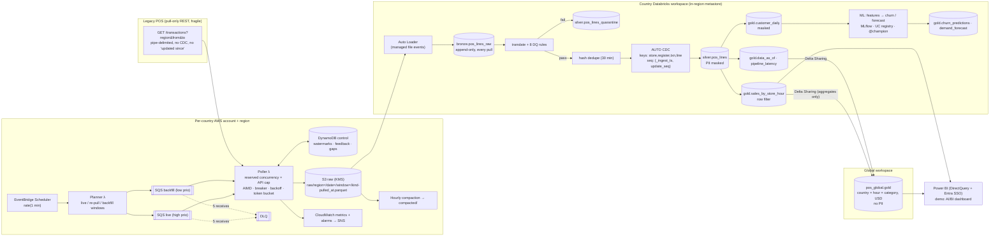
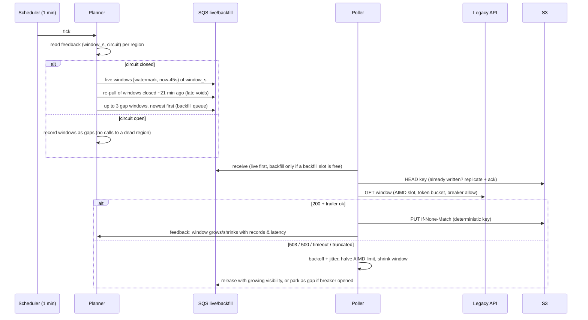
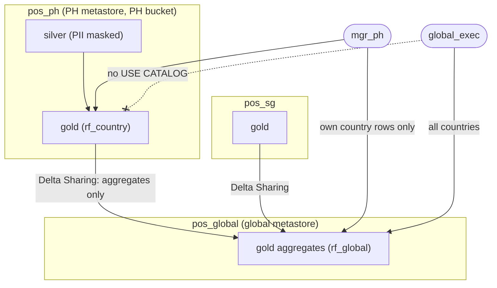
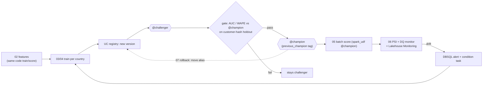

# Architecture

## 1. End to end

In the demo, everything in the AWS box runs locally: the mock API, LocalStack (S3, SQS, CloudWatch, SNS) and `ingestion/run_local.py`. Everything in the Databricks boxes runs in one Free Edition workspace. The poller writes to LocalStack S3 *and* to a UC Volume, because the workspace can't reach a laptop.

## 2. Ingestion control loop

### Why it can't crash the API

- **Global cap.** At most 4 calls are in flight, against a soft limit of 6 (normal) or 3 (peak). In production, Lambda reserved concurrency enforces this across all invocations.
- **AIMD.** Every overload signal (503, 500, timeout, or a body cut short) halves the concurrency limit. Successes raise it again by one at a time.
- **Per-region circuit breaker.** After 3 consecutive failures the region opens. During cooldown nobody calls it; windows are recorded as gaps instead of retried. Recovery is a single half-open probe, and the cooldown doubles each time it fails.
- **Per-region token bucket.** One busy region can't starve the others.
- **Adaptive windows.** Fewer records per call at peak, so each response stays small and fast.

### Why retries are idempotent

- **Deterministic key.** The output key is `region/window/kind-pulled_at`, and `pulled_at` is fixed when the planner creates the task. A retry therefore targets the same key.
- **Write once.** Writes are conditional (`If-None-Match: *`). If the primary object already exists, the poller replicates it and acks; it never re-pulls.
- **Deterministic content.** Lines are sorted, exact duplicates within a response are collapsed, and Parquet is written with fixed settings. The same API content always produces the same bytes.

## 3. Medallion and dedupe semantics

| Layer | Table | Semantics |
|---|---|---|
| Bronze | `pos_<cc>.<env>_bronze.pos_lines_raw` | Auto Loader, append-only, every version of every pull, raw strings plus lineage (`_ingest_ts`, `_record_hash`, `_pull_id`, `_landed_ts`, `_bronze_ts`). The no-reset guard is on in prod |
| Silver | `pos_lines_quarantine` | Rows failing any of 8 named rules, with the failed rule names and the raw line. Append-only |
| Silver | `pos_lines` | Translated: date format and timezone per country, decimal comma, tender and status codes, category, USD. Content-hash dedupe, then AUTO CDC SCD1 on `(store_id, register_id, txn_id, line_no)` sequenced by `(_ingest_ts, update_seq)`. The newest pull wins, so a late void overwrites the sale |
| Gold | `sales_by_store_hour`, `customer_daily`, `data_as_of`, `pipeline_latency` | Materialized views. Row filter on sales, mask on `loyalty_id` |
| Global | `pos_global.<env>_gold.*` | Country × hour × category totals in USD, freshness and latency. Exec/manager row filter |

**Re-pulling is necessary.** The API has no "updated since" filter, so a late void is only visible if the window is pulled again. The planner re-pulls every window about 21 minutes after it closes, since voids happen within 20 minutes of the sale in the demo.

**The two dedupe mechanisms serve different purposes.**
- **AUTO CDC alone is correct.** It is idempotent: re-applying the same pull is a no-op upsert.
- **The content-hash drop is an optimisation.** It removes identical re-pulls before they reach the merge, so most of a re-pull window causes no writes.
- **The watermark is on processing time (`_bronze_ts`) on purpose.** A watermark on sale time or pull time would *drop* genuinely late rows when the pipeline catches up after an outage. With a processing-time watermark, rows can never be late. Anything the drop misses still lands correctly through AUTO CDC.

**Freshness.** `data_as_of` is the end of the newest ingested *live* window, meaning data is complete up to that point. During an outage it stops advancing, so BI shows the region as stale. After recovery, live windows resume first and older windows are backfilled behind them.

## 4. Governance and residency

The trade-offs against Delta Sharing of detail data and against Lakehouse Federation are in [`governance/README.md`](../governance/README.md#alternatives-documented-here-not-built).

## 5. ML lifecycle ("deploy code, not models")

- **Every environment trains its own models.** Dev, staging and prod each run `ml_train` on their own data after the bundle deploy. Model artifacts are never promoted across environments; only code is.
- **Per country, many models.** There is one churn model per country, plus one forecast pyfunc per country that wraps one model per store × category (480–720 groups), fitted in parallel with `applyInPandas`.
- **Fair gate.** The holdout is a fixed 20% of *customers* (hash of `loyalty_id`), so no model version ever trains on it, and champion and challenger are scored on the same unseen data.
- **Batch only.** Scores land in gold tables; there are no serving endpoints.

## 6. Scaling from the demo to 100M records per hour

| | Demo | Production target | How the design scales |
|---|---|---|---|
| Volume | about 50k lines/min (all regions) | 100M lines/h = **28k/s** | Same code. More concurrency per country where the API allows it, windows sized to about 15k records per call |
| API calls | 4 concurrent, 60–600 s windows | about 28k/s ÷ 15k per call ≈ 2 calls/s across all countries | Well within a 4–8 concurrency cap per country at 1–2 s per call. The cap, not the pipeline, is the limit, so negotiate it with the POS team |
| Files | 1 file per pull (0.3–7 MB) | about 120 files/min, 5–50 MB each | Auto Loader with **managed file events**, so listing doesn't grow with history. Hourly compaction for the archive |
| Bronze | about 3M rows/h | 100M rows/h | Liquid clustering on `_window_start`, predictive optimization, row tracking |
| Hash dedupe state | about 1.5M keys (30 min) | about 50M keys | RocksDB state. In prod, use a 16-byte binary hash and a 25-min window, or drop this step and rely on AUTO CDC alone, which stays correct |
| AUTO CDC | serverless, about 7 s per update | 28k rows/s upserts | Serverless autoscaling. Cluster silver by `business_date, store_id`, so merges touch few files and deletion vectors keep them cheap |
| Gold | MVs (some full recompute) | Incremental MVs | Row tracking on silver plus serverless gives incremental refresh. Avoid `current_timestamp()` in large MVs (the demo's latency MV is small) |
| BI | AI/BI dashboard | 5,000 Power BI users | DirectQuery plus SSO on pre-aggregated gold, a warehouse with 1–4 clusters, Power BI aggregations and result cache. See [`powerbi/README.md`](../powerbi/README.md) |

**Latency budget at production scale.**
- Poll is about 5 min (window close, about 45 s lag, pull).
- Processing is about 5 min (triggered every 5 min).
- BI refresh is about 5 min.
- The demo measures 11.9–12.5 min p95 for the first two stages combined, from sale to gold.

## 7. Decisions and trade-offs

| Decision | Alternatives | Why |
|---|---|---|
| SQS plus Lambda poller, planner on EventBridge Scheduler | Step Functions, ECS service, Kafka | Simple, cheap, natural back-pressure. DLQ and redelivery come built in. Reserved concurrency gives a hard global cap |
| Logical `pulled_at` as `_ingest_ts` (sequence column) | Wall-clock receive time | Retries stay byte-identical, while later pulls still sort after earlier ones |
| Triggered pipeline every 5 min | Continuous pipeline | Hits the 15-min SLA at much lower cost. Continuous or real-time mode is a config switch if the SLA tightens |
| AUTO CDC (SCD1) | Hand-written MERGE in foreachBatch | Declarative, handles out-of-order sequencing, less code. SCD2 is one parameter away |
| Global layer from aggregates | Sharing detail, Federation | Strongest residency position and the fastest BI path (see `governance/README.md`) |
| Row filters and masks in UC | Power BI RLS, views per role | Enforced on every engine and every client, with one place to audit |
| One pipeline per country | One pipeline for all countries | Matches the residency boundary (compute stays in-country) and isolates failures |
| Custom PSI monitor plus Lakehouse Monitoring | Lakehouse Monitoring only | The custom monitor compares against the champion's *training* baseline and drives the retrain condition task. Lakehouse Monitoring provides profiles and dashboards |
